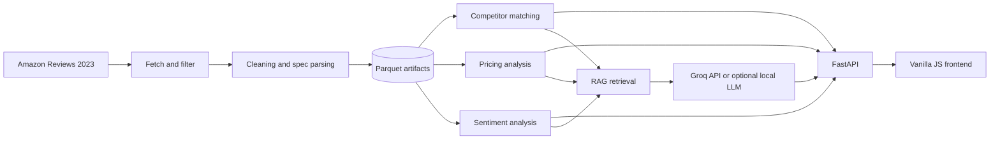

# Laptop Competitor Intelligence

An end-to-end competitor-intelligence system built from the Amazon Reviews 2023 laptop corpus. It combines structured specification parsing, hybrid competitor matching, price-position analysis, aspect-level review sentiment, and retrieval-augmented question answering in a browser application.

The primary interface is a FastAPI backend with a vanilla JavaScript frontend. Chat uses Groq's hosted API by default, so the complete application can run on a CPU server. Product search, competitor matching, pricing, and review analysis also work without chat credentials. The original local NVIDIA model remains available through `LLM_PROVIDER=local`.

## Highlights

- Search and filter 25,841 de-duplicated laptop listings.
- Find competitors using text embeddings and normalized hardware specifications.
- Apply segment, price-band, product-variant, brand-diversity, and renewed-product guards.
- Compare price positioning across brands and market segments.
- Explore sentiment for performance, battery, display, keyboard, build quality, thermals, value, and support.
- View customer-review evidence behind sentiment results.
- Ask catalogue questions through a grounded RAG agent with citations and a post-generation audit.
- Preserve missing-data honesty: an unavailable price is never represented as `$0`.

## Dataset snapshot

| Artifact | Size / coverage |
|---|---:|
| Products | 25,841 listings |
| Retained reviews | 456,395 reviews |
| Products with a listed price | 7,875 (30.5%) |
| Products with mined sentiment | 25,831 (99.96%) |
| Product embeddings | 25,841 × 384 |
| Market segments | 6 |

Price statistics describe only the priced subset and are returned with their sample size and coverage. Brand or segment statistics based on fewer than five priced products are marked unreliable.

## Architecture



## Repository structure

```text
project_final/
├── data/
│   ├── raw/                    # Filtered Amazon metadata and reviews
│   └── processed/              # Catalogue, embeddings, and sentiment artifacts
├── eval/
│   ├── pricing_eval.json       # Pricing validation results
│   └── sentiment_eval.json     # Sentiment validation results
├── report/                     # Project report files (ignored by Git)
├── scripts/
│   ├── fetch_data.py           # Streams and filters the source dataset
│   └── make_docx.py            # Builds the DOCX report
├── src/
│   ├── config.py               # Paths, schema, model names, and segment definitions
│   ├── pipeline.py             # Cleaning, parsing, de-duplication, and segmentation
│   ├── matching.py             # Hybrid competitor matcher
│   ├── pricing.py              # Coverage-aware price analysis
│   ├── sentiment.py            # Review and aspect sentiment
│   ├── rag.py                  # Retrieval, generation, citations, and audit
│   ├── hosted_llm.py           # Groq generation and sanitized provider errors
│   ├── app.py                  # Superseded Streamlit interface
│   └── web/
│       ├── api.py              # FastAPI backend and static-file server
│       ├── test_api.py         # End-to-end API tests
│       ├── test_chat.py        # Offline hosted-chat and quota tests
│       ├── chat_controls.py    # Request limits, cooldown, and answer cache
│       └── static/             # HTML, CSS, and JavaScript frontend
├── requirements.txt
├── requirements-web.txt       # CPU deployment dependencies
├── .env.example               # Chat settings; keep the real .env private
├── Dockerfile                 # CPU deployment, with processed data included
└── README.md
```

## Requirements

- Python 3.12 is recommended.
- Approximately 1 GB of free disk space for the included and generated data artifacts.
- An internet connection is needed only when downloading the dataset or model weights.
- A Groq API key is needed for hosted chat.
- NVIDIA CUDA is needed only when selecting the optional local language model.

The dashboard and hosted chat work on macOS, Linux, and CPU-only systems. MiniLM still runs locally on the CPU to retrieve evidence. Its weights download on the first retrieval question, so that question can take longer. The 7B model is never downloaded in Groq mode.

## Local setup

From the repository root:

```bash
python3.12 -m venv .venv
source .venv/bin/activate
python -m pip install --upgrade pip
```

On Linux, install CPU PyTorch first to avoid downloading CUDA libraries:

```bash
python -m pip install torch --index-url https://download.pytorch.org/whl/cpu
```

Install the web application and CPU retrieval dependencies (on macOS, PyTorch is installed automatically):

```bash
python -m pip install -r requirements-web.txt
```

The full training/pipeline environment, including the optional NVIDIA language model dependencies and legacy Streamlit app, is in `requirements.txt`.

## Run the application

Copy the settings template once, then edit `.env` and set `GROQ_API_KEY` to a key from <https://console.groq.com/keys>. Keep your Groq account on the Free tier for a free demo. The key stays on the server; visitors do not need keys.

```bash
cp .env.example .env
python -m uvicorn src.web.api:app --env-file .env --host 127.0.0.1 --port 8000
```

Preserve an existing `.env` when updating the application. Uvicorn's `--env-file` loads these settings; `python -m src.web.api` and the RAG CLI instead expect exported environment variables. Restart the server after changing chat settings. Without a key, the dashboard remains available and chat reports that it has not been configured.

Open:

- Application: <http://127.0.0.1:8000/>
- Interactive API documentation: <http://127.0.0.1:8000/docs>
- Health and artifact status: <http://127.0.0.1:8000/api/health>

Development mode with automatic reload:

```bash
python -m uvicorn src.web.api:app --env-file .env --reload
```

## API endpoints

| Method | Endpoint | Purpose |
|---|---|---|
| `GET` | `/api/health` | Runtime, artifact, cache, and model status |
| `GET` | `/api/products/search` | Paginated catalogue search and filters |
| `GET` | `/api/products/{asin}` | Product specifications and market position |
| `GET` | `/api/products/{asin}/competitors` | Guarded hybrid competitor ranking |
| `GET` | `/api/products/{asin}/reviews` | Aspect profile and review evidence |
| `GET` | `/api/segments` | Segment price statistics and coverage |
| `GET` | `/api/brands` | Brand price statistics and reliability |
| `GET` | `/api/market/overview` | Headline catalogue analysis |
| `GET` | `/api/chat/status` | Optional LLM availability |
| `POST` | `/api/chat` | Grounded answer with evidence and audit |

## Test the project

Run the end-to-end API suite without loading the LLM:

```bash
python src/web/test_api.py
python -m unittest discover -s src/web -p 'test_chat.py' -v
```

The API suite exercises product, competitor, review, segment, brand, market, and chat-status endpoints, including JSON validity. The chat tests mock only retrieval and the external HTTP service to check the real prompt, generation adapter, citation audit, cache, request limits, GPU bypass, and sanitized failures without using provider quota.

Additional checks:

```bash
python -m compileall -q src scripts
python -m doctest src/pipeline.py src/sentiment.py
python src/matching.py --asin B07L7DVDL3 -k 5
python src/rag.py -q 'Which gaming laptops under $1200 are good?' --retrieval-only
```

## Optional RAG generation

### Hosted chat on a CPU server

The default configuration is:

```dotenv
LLM_PROVIDER=groq
GROQ_API_KEY=your-private-key
GROQ_MODEL=openai/gpt-oss-120b
```

`src/hosted_llm.py` sends the existing evidence-grounded messages to Groq's HTTPS chat endpoint. The same RAG audit still checks citations and figures after generation. GPT-OSS uses low reasoning effort with reasoning excluded from the response, and a 1,024-token reasoning reserve in addition to the requested completion budget. No automatic retries or paid-provider fallbacks run in the background.

The model can be changed with `GROQ_MODEL`; choose one available to your account. Consult the current [supported models](https://console.groq.com/docs/models) and [account limits](https://console.groq.com/docs/rate-limits). Free requests and tokens are shared by all visitors. Their questions and selected product/review evidence are sent to Groq.

The public chat endpoint limits each client IP to **3 requests per minute and 20 per hour**, including cached answers. Successful answers are cached for **10 minutes**, up to **128 entries**, with separate keys for provider, model, question and generation settings. A provider HTTP 429 starts a shared cooldown; responses include `Retry-After`, and the retry button waits for that delay. Cached answers can still be served during the cooldown. Timeouts and service failures return structured errors without exposing credentials or raw provider responses.

These controls are in memory and reset on restart. Run **one Uvicorn worker** for this deployment; multiple workers/replicas would need shared rate-limit/cache storage. Behind a reverse proxy, configure Uvicorn to trust forwarding headers only from that proxy's IP so limits apply to visitor IPs. Visitors sharing an IP share the local allowance.

### Optional local NVIDIA model

Retrieval-only mode uses the MiniLM encoder and does not load the 7B language model:

```bash
python src/rag.py \
  -q 'Compare the Acer Predator Helios 300 with the ASUS TUF Gaming A15' \
  --retrieval-only
```

Local generation uses `unsloth/Qwen2.5-7B-Instruct-bnb-4bit` and requires:

- A working NVIDIA CUDA installation.
- `nvidia-smi` available on `PATH`.
- Roughly 6 GB of free VRAM.
- The approximately 5.5 GB model checkpoint in the Hugging Face cache, or internet access for its first download.

```bash
LLM_PROVIDER=local python src/rag.py -q 'What are the best-value gaming laptops under $1200?'
```

For local web chat, set `LLM_PROVIDER=local` in `.env` and restart Uvicorn. Only this mode checks `nvidia-smi` and loads local generation weights. On CPU-only systems, use hosted chat or retrieval-only mode.

## Deploy with Docker

The image includes the five tracked processed artifacts used by the dashboard and chat. The larger raw corpus and `reviews.parquet` are not needed to serve existing review snippets. It installs CPU PyTorch and the web dependencies without the local 7B model, CUDA libraries, or training tools.

```bash
docker build -t laptop-intelligence .
docker run -d --name laptop-intelligence --restart unless-stopped \
  --env-file .env -p 8000:8000 laptop-intelligence
```

On an Oracle Always Free Ubuntu VM, install Docker, clone this repository, create the private `.env`, and run the commands above. Allow port 8000 through the cloud and host firewall for initial access, then put a reverse proxy with HTTPS in front for ongoing public use. A host that supplies `PORT` is also supported. The key is injected at runtime; `.dockerignore` excludes environment files from the build context.

Verify `/api/health` and `/api/chat/status`, then ask a catalogue question in the browser. A configured chat status means credentials are present; the first real completion verifies provider access. Hosted chat needs more RAM than the dashboard alone because it loads CPU MiniLM and the lexical index. The container build and first model download require outbound internet access. No deployment or provider account is created automatically by these files.

## Rebuild the data artifacts

The repository's `.gitignore` excludes the three source/generated files larger than GitHub's normal file limit:

- `data/raw/laptops_meta.jsonl`
- `data/raw/laptops_reviews.jsonl`
- `data/processed/reviews.parquet`

To rebuild everything from the source dataset:

```bash
python scripts/fetch_data.py
python src/pipeline.py
python src/matching.py --rebuild
python src/sentiment.py --full --device cuda
```

Fetching, embedding, and full sentiment processing can take significant time. The final sentiment command is designed for CUDA; `--device cpu` is available but considerably slower.

Useful alternatives:

```bash
# Fast sentiment baseline
python src/sentiment.py --full --backend vader --device cpu

# Reuse the existing embedding index and run its self-test
python src/matching.py

# Run pricing analysis from the processed catalogue
python src/pricing.py
```

## Analytical design

### Competitor matching

The matcher blends cosine similarity from `all-MiniLM-L6-v2` product embeddings with a masked structured distance over CPU tier, RAM, storage, screen size, GPU type, and price. A configurable guard removes incompatible market segments, implausible price-band matches, duplicate model variants, and optionally same-brand or renewed listings.

### Pricing

Pricing functions always report the number and coverage of priced products. They include segment and brand summaries, percentile positioning, discrete-GPU premiums, price/rating relationships, and a regularized specification-based value model.

### Sentiment

Reviews are split into clauses, mapped to eight product aspects using cue patterns, and scored with a transformer model. A VADER backend is retained as a faster baseline. Product-level artifacts store aggregate polarity, positive share, mention counts, and ranked praise/complaint snippets.

### RAG and grounding

Question parsing and evidence retrieval are deterministic. Product, review, and market-statistic evidence blocks receive markers such as `[P1]`, `[R1]`, and `[S1]`. After generation, an audit checks unsupported markers, uncited statements, unverified numbers, and reviews attributed to the wrong product.

## Known limitations

- Only 30.5% of listings contain a price, so price conclusions apply to the priced subset.
- Product specifications are parsed from noisy marketplace text and may occasionally be incomplete.
- Aspect detection is cue-based and can miss inflections or misread ambiguous words.
- Hosted chat depends on Groq availability and its shared account quotas; free access does not guarantee unlimited usage.
- The optional local generation backend requires NVIDIA CUDA.
- The legacy Streamlit interface in `src/app.py` is retained for reference but is not the recommended application entry point.

## Data source

Hou, Y., Li, J., He, Z., Yan, A., Chen, X., and McAuley, J. (2024). *Bridging Language and Items for Retrieval and Recommendation.* Amazon Reviews 2023, McAuley Lab, UC San Diego.

Dataset website: <https://amazon-reviews-2023.github.io/>
